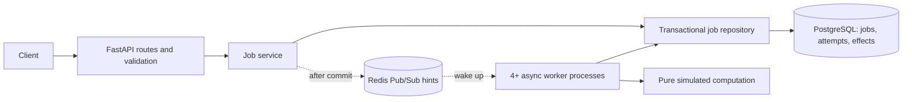
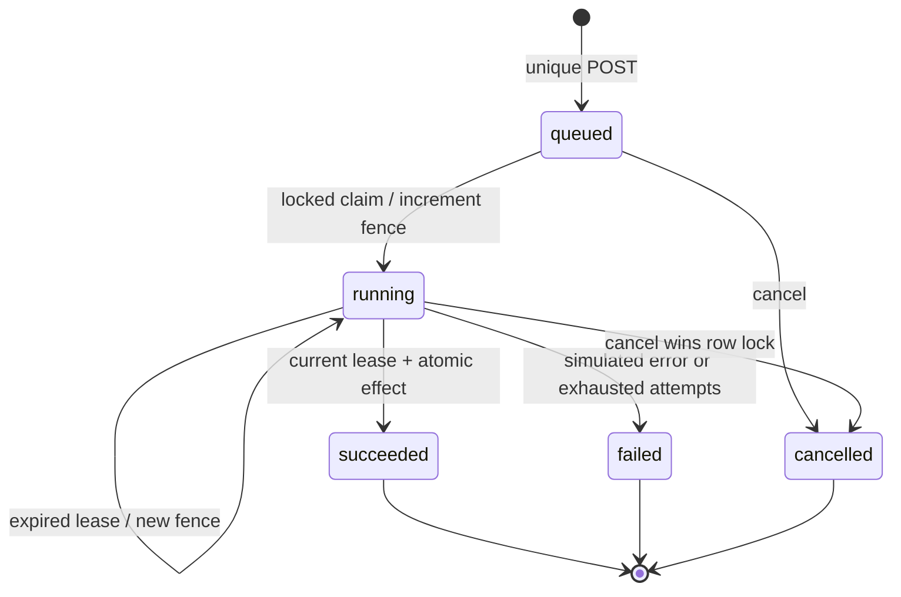

# Architecture and decisions

The architecture is a small layered application with one aggregate: a job and its attempt/effect records. It uses an application service for create-and-notify orchestration, a repository for the transactional queue protocol, dependency injection through the FastAPI lifespan, and a protocol for the notification boundary. Each repository operation uses a fresh SQLAlchemy `AsyncSession` and `begin()` as its unit of work. Transactions are short and never span simulated training or Redis calls.

| Layer | Responsibility |
| --- | --- |
| `src/main.py`, `src/config.py` | Application composition, lifespan, route registration, environment settings |
| `src/api/web/jobs/` | Job routers and response schemas, grouped by feature |
| `src/api/web/health/` | Liveness and dependency-readiness routes |
| `src/api/web/dependencies.py`, `exceptions.py`, `middleware.py` | HTTP dependency injection, error translation, request context |
| `src/application/services/jobs.py` | Create/get/list/cancel orchestration; commit creation before the optional wake-up |
| `src/core/dto/jobs.py`, `enums/jobs.py`, `exceptions.py` | Training specification, job snapshot, immutable claim token, states, semantic errors |
| `src/core/interfaces/` | Repository and notification protocols consumed by the application |
| `src/infrastructure/adapters/di/container.py` | Construction and cleanup of application-scoped resources |
| `src/infrastructure/repositories/` | Locking, idempotency, leases, fenced transitions, atomic effects, cursors |
| `src/infrastructure/database/` | SQLAlchemy engine/session factory, models, uniqueness, checks, queue indexes |
| `src/infrastructure/adapters/storage/redis.py` | Bounded Redis publish and reconnecting subscription |
| `src/worker.py` | Independent worker lifecycle, lease-renewal task, cancellation of computation |
| `scripts/chaos.py` | External HTTP driver, process supervisor, fault injection, independent SQL audit |

The layout follows the supplied [reference](https://github.com/Asylniet/fastapi-demo-project/tree/main/src/api/web), with `main.py` beside `config.py` as requested. Feature modules expose `APIRouter` instances. The application service depends on repository and notification protocols in `core/interfaces`; it receives immutable job snapshots rather than ORM objects. Core and application modules have no imports from infrastructure or the HTTP layer. The DI container selects concrete SQLAlchemy and Redis implementations at startup. FastAPI's dependency injection supplies services to routes.

The repository owns the complete queue transaction protocol. Each operation creates its own async session/unit of work, so concurrent worker tasks never share a session. Models, claims, and effects retain the existing transactional behavior during the restructure.

## State transitions

Terminal states never transition. An accepted cancellation revokes the lease in the same transaction. A worker may continue local computation briefly, but cannot write the effect. A failed renewal cancels the computation task. On SIGTERM the process stops its tasks and lets any owned lease expire; on SIGKILL PostgreSQL rolls back uncommitted transactions and other workers reclaim committed leases.

Completion locks the job, reads fresh database time, checks status/owner/fence/expiry, inserts the unique effect, closes the attempt, and updates the job. The transaction commit is the visibility boundary. If it holds the lock while crossing a lease deadline, competing cancellation/reclaim waits; the lock and terminal-state check still serialize the winner. The clock check occurs after acquiring the lock, preventing an expired waiter from publishing based on an earlier timestamp.

## Intentional limits

- Redis is an optimization. A crash between PostgreSQL commit and publish adds at most polling delay; there is no dual-write correctness dependency. Pub/Sub may wake every worker, so the notification path can produce a thundering herd at larger scale.
- The effect is a database row. CPU time may be spent more than once. Files, remote GPUs, and other side effects need their own deduplication/fencing contract; an outbox alone cannot make a non-idempotent receiver exactly once.
- Database constraints protect row shape and unique keys. Cross-table state/effect consistency depends on the repository transaction protocol; direct SQL with application credentials could violate it.
- `READ COMMITTED` is explicit. Row locks serialize job transitions; unique constraints serialize key reuse. Replacing it with `REPEATABLE READ` changes the create-conflict behavior and would require transaction retries.
- Worker wall clocks do not grant leases. A jump of the **database clock** can still delay recovery or cause early lease expiry; fencing preserves ownership after a reclaim, but this is not a complete clock-failure model.
- The claim query and connection count need capacity testing as history grows. Partial indexes help, but the combined queued/expired predicate and ordering can still scan old rows; no claim of unlimited horizontal scale is made.
- Authentication, tenant isolation, rate limits, durable external execution, retention, deployment HA, alerting, and backup restoration are release work, described in the verdict.
